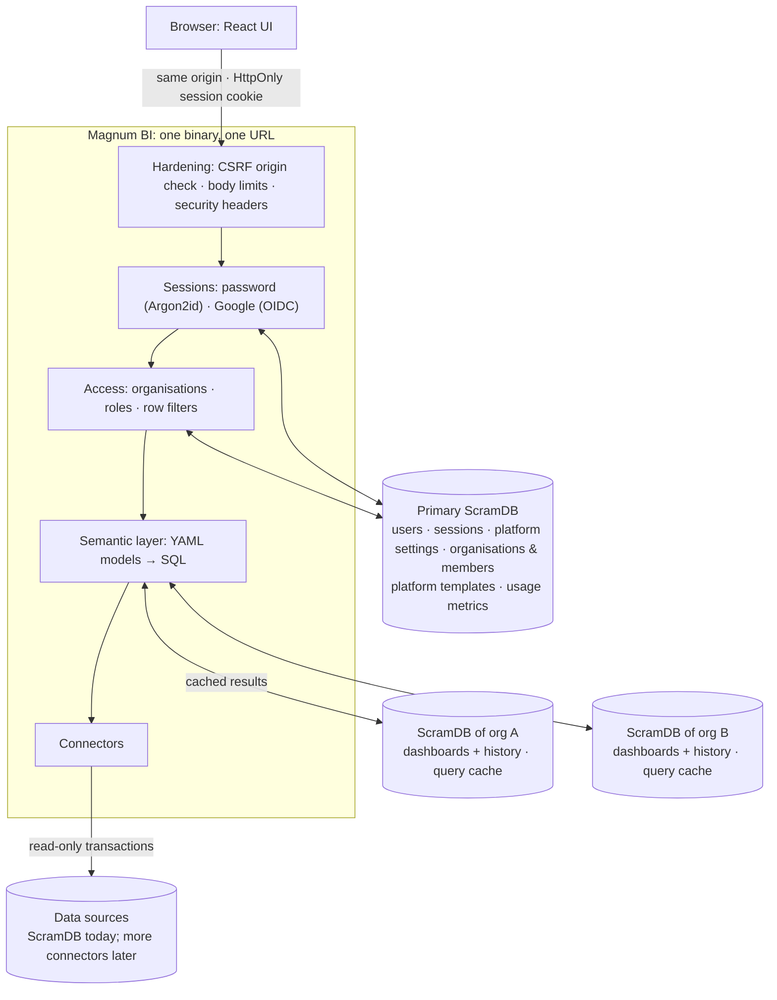

# Magnum BI

A lightweight BI tool: semantic models and dashboards as YAML, queries on
[ScramDB](https://scramdb.com), a drag-and-drop explorer, drill-down, period comparison, and
one-line embedding. The backend is Rust (axum + tokio-postgres); the UI is React.

## Quick start

Prerequisites: Rust 1.88+, Node 20+, and Podman or Docker (for the local ScramDB).

```bash
make install                                  # frontend dependencies
make db-up                                    # the primary ScramDB on 127.0.0.1:55432 (container)
make seed                                     # the `sample_sales` demo table (≈46k rows)
echo 'MAGNUM_SYSTEM_OWNERS=you@example.com' > .env.local
make key                                      # MAGNUM_SECRET_KEY, for organisation databases
make user EMAIL=you@example.com               # choose a password
make dev-backend                              # API on :8000 (migrates ScramDB on start)
make dev-frontend                             # UI on :5173, in another terminal
```

Open http://localhost:5173 and sign in. The **Sales overview** dashboard runs on the sample data.
To try organisations: create one on **Organisations** (e.g. `acme`), then give it its own
ScramDB with `make org-db ORG=acme PORT=55433` (or **Database › Set…** on that page).
For one process serving the API and the built UI on :8000, run `make serve`. Run `make test`
for the backend tests, the frontend typecheck and the frontend tests (Vitest) (`make test-db` also runs the tests that need
ScramDB and, with `MAGNUM_TEST_POSTGRES_URL`, a real PostgreSQL), and `make check` to validate the project files.

**A bigger demo: NYC taxi trips.** `make nyc-taxi ORG=globex` downloads five years of New York
yellow taxi trips (NYC TLC open data, 3.3 GB) and cleans them into ~208 million rows of Parquet
in that organisation's DuckDB folder (`devtools/nyc_taxi.py`, needs `uv`). Then, in that
organisation: **Connections › New**, DuckDB, name `nyc_taxi`, table
`trips = nyc_taxi/trips/*.parquet`; and import `project/dashboards/nyc_taxi.yaml` as dashboard
`nyc_taxi` (model `taxi`). Tiles take about a second on a month and ~5 s on all five years,
then come from the organisation's query cache. The same target fetches hourly weather per
borough for those five years (`devtools/nyc_weather.py`: Open-Meteo, ERA5 reanalysis, CC BY 4.0);
the demo reads it from PostgreSQL, another engine than the trips: load
`nyc_taxi/weather/hourly.parquet` into a table `weather.hourly` and add a PostgreSQL connection
`meteo` (schema `weather`). The blend `taxi_weather` (see Blends below) joins trips and weather on
borough + hour (both New York local time); the dashboard's last three tiles use it.
Temperature is per ~9 km cell; precipitation, snow and gusts come from a ~25 km grid, so
neighbouring boroughs can share them.

## Project layout

```
project/                    your content (git it)
  models/*.yaml             semantic models: dimensions, measures, drill hierarchies
  blends/*.yaml             models joined on shared fields, across connections
  dashboards/*.yaml         dashboards seeded into ScramDB on first start (file stem = id)
  themes/*.yaml             optional extra themes
  access.yaml               optional: initial organisations/members, adopted on first start
backend/                    Rust: the API server and CLI (crate `magnum-bi`)
  migrations/primary/       schema of the primary ScramDB } embedded in the binary,
  migrations/org/           schema of each organisation's  } applied automatically
  src/
    api/                    HTTP handlers (auth, models & queries, dashboards, admin, usage)
    auth/                   sessions; sign-in: passwords (Argon2id) + authenticator codes, passkeys,
                            Google and organisations' own OpenID Connect providers; policies
    connections.rs          organisations' data connections (settings, validation)
    connectors/             where queries run: ScramDB/Postgres, BigQuery, DuckDB
    access.rs               organisations, roles, row filters
    compiler.rs             semantic query → SQL
    blend.rs                blends: per-engine parts, then the join on ScramDB
    api/tokens.rs           API tokens for agents and scripts
    api/mcp.rs              MCP endpoint: tools for AI agents over the API
    orgdb.rs                each organisation's own ScramDB (routing, registration)
    cache.rs, materialize.rs  results as typed tables in ScramDB (the query cache, blends)
    usage.rs                usage metrics
    crypto.rs               sealing organisations' connection strings (AES-256-GCM)
    project.rs, schema.rs   loading and validating the YAML files
    store.rs, db.rs         tables and migrations
frontend/                   React + Vite + ECharts + react-grid-layout
devtools/scramdb.sh         local ScramDB containers: the primary and one per organisation
devtools/nyc_*.py           demo data: NYC taxi trips and borough weather
```

## Architecture



- **One service, one URL.** The server serves the built UI and `/api`, so the browser only ever
  talks to one origin. Cookies, CSRF checks and the CSP rely on that.
- **A primary ScramDB** (`MAGNUM_DATABASE_URL`) is the configuration and system database:
  identity (users, sessions), platform settings, organisations with their members, roles and row
  filters, platform templates, and the usage metrics of the whole platform.
- **One ScramDB instance per organisation** holds what is only that organisation's: its
  dashboards (with every saved version) and its query cache. System owners register each
  instance on the Organisations page; the connection string is tested, the instance migrated,
  the organisation's existing dashboards moved there, and the string stored sealed with
  `MAGNUM_SECRET_KEY` (AES-256-GCM, bound to the organisation). It fails closed: an organisation
  without an instance can't open dashboards, and an unreachable instance only affects its own
  organisation (503), never sign-in or other organisations. Members stay in the primary database
  because sign-in must find a person's organisation before it can open that organisation's
  database. (ScramDB doesn't reliably isolate several databases on one instance, so this is one
  *instance* per organisation; for development, several organisations may share one, even the
  primary: rows carry the organisation id.)
- **Stateless server.** All state is in ScramDB, so replicas are interchangeable; each replica
  re-reads the organisation registry every few seconds. Migrations run at startup
  (`MAGNUM_DB_AUTO_MIGRATE=0` to turn off; `magnum-bi migrate` for the primary alone;
  organisation databases migrate when first used). ScramDB DDL isn't transactional, so every
  migration statement is idempotent.
- **Data.** Queries are compiled from the models, in the SQL dialect of the organisation's
  connection. Only declared fields can be referenced and every value is an escaped literal; SQL
  inside models (`sql:`) is trusted configuration.

## Data connections

Each organisation has its own connections, in its own ScramDB, managed on **Connections** by its
Org admins (and system owners). Settings are stored as-is; the secret (password, service-account
key, storage keys) is sealed with `MAGNUM_SECRET_KEY` for that organisation and connection, and
is never shown again. **Test** checks settings before they are saved.

Models are platform YAML and only *name* a connection, with unqualified tables:
`connection: warehouse`, `table: sample_sales`. Each organisation's `warehouse` decides where that
is: so one model (and one dashboard) serves every organisation, each from its own data with its
own credentials.

| type | where `table: sample_sales` is | secret | notes |
|---|---|---|---|
| ScramDB, PostgreSQL | the connection's `schema` (search_path) | password | read-only transactions, statement timeout; TLS verified against public CAs, never downgraded |
| BigQuery | the connection's `project` + `dataset` | service-account JSON key | every query dry-run first and refused over `max_bytes_billed` (also sent as BigQuery's own cap) |
| DuckDB | `tables:` (name = files) or a `.duckdb` file | optional S3 / GCS HMAC keys | see below |

**DuckDB** runs each query in a fresh sandbox: in memory, or the organisation's `.duckdb` file
opened read-only. Tables are views over files in the organisation's own directory
(`MAGNUM_DUCKDB_DIR/<org>/`) or its object storage (`s3://`, `gs://`, `https://`): Parquet, CSV,
JSON or Avro files (globs allowed), or Iceberg tables as `iceberg:<table folder>`, e.g.
`orders = iceberg:s3://acme-lake/warehouse/retail/orders`. An Iceberg table is read at its latest
metadata version (`version-hint.text`, else the highest-numbered metadata file), with data files
resolved inside the table's folder; catalogs (REST, Glue) aren't supported yet. Then the sandbox
is locked: only those directories and prefixes are reachable, no extensions, no settings changes,
no writes. Object storage, Avro and Iceberg need DuckDB extensions (`httpfs`, `avro`, `iceberg`),
downloaded once into `MAGNUM_DUCKDB_DIR/_extensions` (or pre-installed there; set
`MAGNUM_DUCKDB_INSTALL_EXTENSIONS=0` to forbid downloads). This DuckDB build has no ICU
extension, so `time` columns are handled as UTC timestamps.

`make seed` gives the platform workspace a `warehouse` connection to the sample; organisations
add their own.

## Query cache (and the federation bridge)

A model opts in with `cache: 15m` (any duration up to 30 days; off by default, so live data
stays live). Results are cached in the organisation's own ScramDB, keyed by organisation +
connection + compiled SQL. The SQL already contains the person's row filters and the
(5-minute-rounded) period window, so people share a cached result only when they'd get the
same rows anyway. Builders can bypass it (`x-magnum-refresh: 1`); Org admins see and clear it
on **Usage**. Up to 2,000 results per instance, least recently used dropped first.

Each cached result is a **typed table** (`magnum_cache.r_…`, indexed by
`magnum_cache.entries`), not a JSON blob: the same mechanism blends use to join sources.
Connectors therefore report neutral column types (`materialize::ColType`) along with rows.

## Blends: joining models across engines

A blend joins models on fields they share, even when their data is in different databases.
Define one in code (`project/blends/*.yaml`) or, as a power user, on **Blends** in the UI (kept in
the organisation's own ScramDB, for that organisation only):

```yaml
name: taxi_weather
label: Taxi trips × weather
base: taxi                       # every row of the result starts from it
joins:
  - model: weather
    on:
      - pickup_borough = borough
      - pickup_at:hour = observed_at:hour   # dates/times match at a grain
cache: 1h
```

Its fields are the models' fields as `model.field` (`taxi.trips`, `weather.condition`), and it is
used like any model in Explore and on dashboards (a dashboard's period and filters on `taxi` apply
to it too). A query runs in two steps (`blend.rs`, `api/blends.rs`):

1. **Aggregate, per engine.** Each model involved gets its own query on its own connection (DuckDB,
   BigQuery, PostgreSQL, ...), with that model's data restrictions, grouped by the join keys and
   the dimensions asked for. Measures are split into parts that add up again (an average becomes
   a sum and a count). A query touching one model only runs on it directly.
2. **Join on ScramDB.** The parts are written to the organisation's ScramDB (`COPY`, about 0.1 s
   per 60,000 rows), joined (the base `LEFT JOIN` each model; `INNER` when the query filters that
   model's own fields), and the person's query is compiled over the join as an ordinary model:
   grouping, sorting, top N and period comparison work as usual. The tables are dropped right
   after; the result is cached like any other (`cache:`).

Limits, by design: measures must add up (count, sum, min, max, avg), so distinct counts and custom
SQL measures stay on the models themselves; a period must be on a date/time field the models are
joined on (both windows are fetched from every model); each part may return up to 1,000,000 rows
at the join keys. When a model has several rows per join key for the fields asked for, the other
models' measures would be counted more than once: such queries are refused with an explanation.
The SQL preview in Explore shows every part and the join.

On the NYC demo, a dashboard tile joining a month of trips (DuckDB, 3.5 million) with the weather
(PostgreSQL), compared with the same month a year earlier, takes about 2 s: ~1.2 s in DuckDB,
~0.5 s in PostgreSQL, ~0.7 s joining 118,000 rows on ScramDB; then 0 s from the cache.

## Usage metrics

Sign-ins, queries (source, model, rows, time, cache hit, failures), dashboard views and saves,
and admin actions are recorded in the primary database (`usage_events`). Recording never slows
or fails a request: events are buffered and written in batches. They are kept
`MAGNUM_USAGE_RETENTION_DAYS` (default 400). **Usage** shows Org admins their organisation and
system owners the whole platform (or one organisation, from inside it).

## Sign-in

Every method ends in the same server-side session (an opaque token in an HttpOnly cookie;
ScramDB stores only its SHA-256). The sign-in page asks for the email first, then offers the
ways that person's organisation allows.

- **Password** (on by default; `MAGNUM_PASSWORD_LOGIN=0` turns it off). Argon2id hashes, at
  least 10 characters, lockout for 15 minutes after 5 failures. Accounts get a password from:
  - the server: `magnum-bi user set-password you@example.com` (system owners, recovery);
  - an Org admin: **Members › One-time password…** creates a one-time password to hand over. The
    person must choose their own at the next sign-in;
  - the person themselves: **Security** in the top bar.
- **Authenticator codes** after the password (TOTP, RFC 6238: any authenticator app), set up
  under **Security** with a QR code, plus 10 one-time recovery codes. A code is good once; wrong
  codes count like wrong passwords. The secret is sealed with `MAGNUM_SECRET_KEY`.
- **Passkeys** (WebAuthn: Touch ID, Windows Hello, phones, security keys), added under
  **Security**. The relying party is `MAGNUM_PUBLIC_URL`'s host (in development: `localhost`
  on the server's port and Vite's, so open it as localhost, not 127.0.0.1). Uses `webauthn-rs`,
  which needs the system's OpenSSL library at build time.
- **Google** (optional): set `MAGNUM_GOOGLE_CLIENT_ID` / `MAGNUM_GOOGLE_CLIENT_SECRET` (see
  `.env.local.example`). PKCE, a browser-bound state, and an ID token verified against Google's
  keys; only a Google-verified email is accepted, and the email is bound to that Google account.
- **An organisation's own single sign-on** (OpenID Connect: Microsoft Entra ID, Okta, Keycloak,
  Auth0, Google Workspace, ...), set up by its Org admins under **Members › Sign-in**: issuer,
  client id and secret (sealed, never shown again), and provider groups mapped to roles (up to
  Org admin). Endpoints and keys come from the issuer's discovery document, through the network
  guard. It signs in **only addresses on the organisation's own domains** (set by system
  owners), never a system owner; listed members keep their own role, everyone else gets a role
  from their groups or the default role.

**Policies.** Which methods people may use, and whether passwords need an authenticator code,
is set at three levels: the platform (system owners, **Organisations › Sign-in**), the platform
for one organisation (same page), and the organisation itself (its Org admins, **Members ›
Sign-in**). Methods allowed = what the server offers ∩ every level; a requirement at any level
holds. So organisations choose within the platform's rules and can only tighten them. Policies
are checked at sign-in and on every request: a stricter policy signs out sessions that no longer
meet it, and someone who now needs an authenticator code must set one up before anything else.

An account whose password was issued by an Org admin is **bound to that organisation**. With
that password it can never act as a system owner or in another organisation, because the admin
could have created it for an email they don't own. Other methods, or a password set by a
system owner or on the server, aren't bound.

Disable an account with `magnum-bi user disable <email>`; this also ends its sessions.

## Agents and automation

Agents (MCP clients, scripts, CI, notebooks) use the same API as the UI, with an **API token**
(`Authorization: Bearer mbi_...`), made under **Security › API tokens**:

- it acts for the person who made it, in the organisation they made it in, with at most their
  role (or a lower one chosen at creation): row filters and organisation isolation apply as usual;
- **read-only** (reading, queries, dry runs) or **read & write**; it always expires (90 days by
  default, at most 365); only a SHA-256 is stored, and the secret is shown once;
- it can't make tokens or change how anyone signs in; revoking it (or disabling the account)
  stops it at once. Org admins see and revoke every token of their organisation (`GET
  /api/tokens?all=true`), and everything a token does is in the usage log as `token:<name>`;
- tokens are a sign-in method in the policies ("API tokens"): the platform or an organisation
  can switch them off.

**MCP** (Model Context Protocol): `POST /api/mcp` lets Claude Code, Cursor, Claude Desktop and other
MCP clients use Magnum BI as a tool, with an API token. Making a token under **Security** shows the
setup for each client, e.g. Claude Code:

```bash
claude mcp add --transport http magnum-bi https://bi.example.com/api/mcp --header "Authorization: Bearer mbi_..."
```

Tools (`api/mcp.rs`): `list_models`, `describe_model`, `run_query`, `preview_sql`, `list_dashboards`,
`get_dashboard`, `validate_dashboard`, `save_dashboard`, `delete_dashboard`, `dashboard_history`,
`list_blends`, `save_blend`, `delete_blend`, `list_connections`, `save_connection`,
`delete_connection`, `get_members`, `save_members`, `usage_summary`. Each calls the API handler
a browser would, as the token's person, so permissions, row filters, dry runs and version checks
are the API's own. Agents see only the tools they may use; read-only tokens get no writing tools.
Every tool call is in the usage log. The endpoint is stateless JSON-RPC (streamable HTTP transport
answering in JSON; protocol versions 2025-03-26 to 2025-11-25); checked with the official MCP
Inspector.

Two safety nets for changes made by agents (and people):

- **Dry runs**: `?dry_run=1` on `PUT /api/dashboards/{id}` (JSON), `PUT /api/dashboards/{id}/yaml`,
  `PUT /api/blends/{name}` and `PUT /api/members` checks everything and reports warnings (e.g. a
  tile on a field that doesn't exist) without saving. Read-only tokens may make them.
- **Versions**: reads of a dashboard or of the members return a `version`; send it back as
  `If-Match: <version>` and the save is refused with 409 (and the current version) if someone
  changed it meanwhile, instead of silently overwriting their work. `If-Match: none` creates
  only if it doesn't exist yet. The dashboard editor does this too. Deleted and overwritten
  dashboards stay in their history.

## Organisations and roles

| role         | can                                                                   |
|--------------|-----------------------------------------------------------------------|
| Viewer       | view dashboards, use their filters and the period picker              |
| User         | + drill down, embed                                                   |
| Power user   | + create / edit / delete dashboards, Explore, see SQL and YAML        |
| Org admin    | + manage the organisation's members, roles and personal filters       |
| System owner | everything, in every organisation (switch with the organisation picker) |

- Each organisation has its own members, dashboards and models, and none of them are visible
  across organisations.
- People join as listed members, or automatically by email domain with a default role (never an
  admin role).
- **Row filters** only ever narrow what someone sees. Organisation filters are set by system
  owners and personal filters by Org admins. A filter also covers every model reading the same
  data (`extends` family, or the same connection and table). Anything misconfigured fails closed.
- Before the first save on **Organisations**, the system owners are `MAGNUM_SYSTEM_OWNERS`.
- Anyone can preview a lower role ("view as"), never a higher one.
- Dashboards in the platform workspace are templates: **Publish…** copies one into organisations.

## Models and dashboards

```yaml
# project/models/sales.yaml
name: sales
connection: warehouse         # each organisation's own `warehouse`
table: sample_sales            # unqualified: the connection decides the schema/dataset/files
dimensions:
  - {name: sold_at, type: time}           # string | number | boolean | date | time | datetime
  - {name: region}
  - {name: store, aggregation: count_distinct}
measures:
  - {name: revenue, type: sum, sql: amount, format: currency}
  - {name: transactions, type: count}
  - {name: revenue_per_unit, type: number, sql: SUM(amount) / NULLIF(SUM(qty), 0)}
hierarchies:
  location: [region, store]    # drill path
```

A model can `extends:` another and add fields. Dashboards (see
`project/dashboards/sales_overview.yaml`) declare tiles with a query each, dashboard filters, and
an optional dashboard period with comparison (`previous_period`, `previous_year`, or
`{from: <date>}`). Queries support time grains (`sold_at:month`), ad-hoc aggregations of any
column (`sum(amount)`, `count_distinct(store)`), filters, Top/Bottom N and sorting by change
(`-revenue__change`).

Viewers never send queries: they ask for a saved tile with values for the dashboard's own
filters, a period window and drill clicks, and the server rebuilds the query from the saved tile.

## Embedding

```html
<script src="https://bi.example.com/embed.js"></script>
<magnum-dashboard dashboard="sales_overview" filters="category=Footwear"></magnum-dashboard>
```

Or an iframe on `/embed/<id>`. Allowed host pages are set with `MAGNUM_FRAME_ANCESTORS`. For
embeds on other sites, use `MAGNUM_COOKIE_SAMESITE=none` over https.

## Configuration

| variable | default | |
|---|---|---|
| `MAGNUM_DATABASE_URL` | `postgresql://scramdb@127.0.0.1:5432/scramdb` | the primary ScramDB |
| `MAGNUM_SECRET_KEY` | | seals organisations' connection strings (`magnum-bi gen-key`); required in production |
| `MAGNUM_USAGE_RETENTION_DAYS` | 400 | how long usage events are kept |
| `MAGNUM_DUCKDB_DIR` | `data/duckdb` | DuckDB files, one directory per organisation |
| `MAGNUM_DUCKDB_INSTALL_EXTENSIONS` | 1 | allow downloading DuckDB's `httpfs`, `avro` and `iceberg` extensions |
| `MAGNUM_ALLOW_PRIVATE_CONNECTIONS` | 1 (0 with `MAGNUM_ENV=production`) | organisations' connections may reach private networks |
| `MAGNUM_CONNECTION_ALLOWED_HOSTS` | | private hosts organisations' connections may reach anyway |
| `MAGNUM_CLIENT_IP_HEADER` | | behind a proxy: header with the client address (e.g. `x-forwarded-for`) |
| `MAGNUM_SYSTEM_OWNERS` | | comma-separated emails, until organisations are first saved |
| `MAGNUM_PUBLIC_URL` | | public https address (cookies `Secure`, OAuth callbacks, origin checks) |
| `MAGNUM_ENV` | development | `production`/`staging` refuse to start with unsafe settings |
| `MAGNUM_PASSWORD_LOGIN` | 1 | password sign-in on/off |
| `MAGNUM_GOOGLE_CLIENT_ID` / `_SECRET` / `_HD` | | Google sign-in |
| `MAGNUM_SESSION_HOURS` | 12 | session lifetime |
| `MAGNUM_COOKIE_SAMESITE` | lax | `none` for cross-site embeds (https only) |
| `MAGNUM_TRUSTED_ORIGINS` | | extra origins allowed to send POST/PUT/DELETE |
| `MAGNUM_FRAME_ANCESTORS` | `'self'` | CSP frame-ancestors for embeds |
| `MAGNUM_HOST` / `MAGNUM_PORT` | 127.0.0.1 / 8000 | listen address |
| `MAGNUM_PROJECT_DIR` / `MAGNUM_FRONTEND_DIST` | `project` / `frontend/dist` | paths |
| `MAGNUM_DB_AUTO_MIGRATE` | 1 | migrate ScramDB at startup |
| `MAGNUM_LOG` | `magnum_bi=info` | log filter |

## Security

- Every rule is enforced by the server; the UI only hides what a role can't use.
- Organisations' connections can't reach the platform's internals (`netguard.rs`): loopback,
  private, link-local and cloud-metadata addresses are refused (outside development, unless
  allowlisted), the platform's own databases always. Host names are resolved and every address
  checked; SQL connections are pinned to the checked address, so a second DNS answer can't
  redirect them. BigQuery tokens only ever come from Google. Failed connection tests don't say
  whether a port is open.
- Sign-in: 5 failures lock an account and 20 lock a client address for 15 minutes (password
  spraying), and only a few password hashes run at once. Every failed sign-in is recorded
  (`sign_in_failed` in the usage events, with the reason and address).
- CSRF: state-changing requests must come from Magnum BI's own origin (Origin / Sec-Fetch-Site),
  which covers sibling subdomains too. That's on top of `SameSite=Lax` HttpOnly cookies.
- Headers: a strict CSP, `nosniff`, a referrer policy, HSTS on https, and `no-store` on the API.
- Request bodies are limited to 1 MB; YAML files to 512 KB, with alias expansion capped.
- Query errors show database details only to roles that may see SQL. Everyone else gets a
  reference to look up in the server log.

## Roadmap

Everything new follows the [organisation isolation rules](docs/org-isolation.md), so organisations
can become fully independent (own keys, credentials, servers) without rewrites.


Next, in rough order:

- More **connectors** (Snowflake, MySQL, ...): a `ConnectionConfig` variant (`connections.rs`),
  a `Dialect` where SQL differs (`compiler.rs`), and a `Connector` (`connectors/`).
- **Federated queries** across connections, joined in the organisation's ScramDB (on top of the
  cache's materialisation).
- Formulas (a calculated-field language), shared per organisation (from the earlier Python version, like the next two).
- Share links / QR codes, guest links for people without an account.
- Configuration as code (`plan` / `apply` of organisations from git), automation tokens.
- ThoughtSpot liveboard import (from the earlier Python version).
- TLS to the primary and organisation ScramDB instances (data connections already support it).

## License

Copyright (C) 2026 Giovanni Andrea Binda. Magnum BI is free software under the
[GNU Affero General Public License v3.0](LICENSE), with two additional terms (see [NOTICE](NOTICE)):
the "Powered by Magnum BI" credit must stay visible in the user interface, and the name and logo
are covered by the [trademark policy](TRADEMARKS.md).

You may use, modify and run Magnum BI commercially. If you offer a modified version to others over
a network, you must publish your changes under the same license. If that doesn't suit you, for
example for a closed-source hosted service, a commercial license is available from the author
(gbinda@pm.me).
