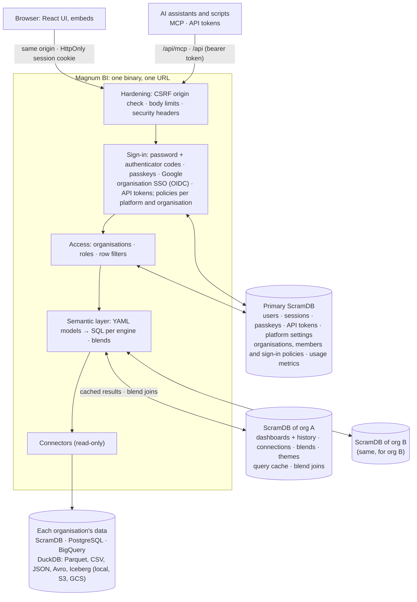

# Magnum BI

**Dashboards your whole company can use: fast, simple, and safe to share between teams and
customers.**

Magnum BI turns your data into clear, interactive dashboards. Analysts build them by dragging and
dropping; everyone else just opens them. One installation serves many organisations, each with
its own people, data and look, and nothing ever leaks from one to another.

**Website: https://giobinda.github.io/magnumbi/**

> **Early alpha.** It works and is tested, but configuration, APIs and file formats will change
> between versions, with no upgrade path guaranteed yet. Try it and pilot it; it isn't ready for
> production. If you build on it, pin a version.

## Why Magnum BI

**Fast.** The server is a single Rust program, and dashboards ask the database for answers, not
raw data: the work happens where your data lives. Results can be cached, so the second person to
open a dashboard gets it instantly. On the NYC demo, a tile that combines 3.5 million taxi trips
with the weather, compared with a year earlier, takes about 2 seconds, then no time at all from
the cache.

**Easy to use.**
- **For viewers:** open a dashboard, pick a period, click a bar to drill down (region, then
  store). Every chart can compare with the previous period or the previous year, without anyone
  writing a formula.
- **For analysts:** **Explore** is drag and drop. Choose measures and dimensions and the chart
  appears; save it to a dashboard. Measures are defined once, so "revenue" means the same thing
  on every dashboard.
- **Combine sources:** join data from different systems in one chart (for example, sales from
  your warehouse with the weather) without copying databases around.
- **Your company's colours:** build a theme visually, with readability checks, or import your
  design team's tokens. Export the same colours as CSS for your own website.
- **Put dashboards anywhere:** embed one in your intranet or product with a single line of HTML,
  share it with anyone through a public link and QR code, served from a cache so a popular
  link can't overload your data warehouse, or with guests through a link and a password, for up
  to 14 days, limited to the data you choose.

**Many organisations, fully separate (multi-tenant).** Run one Magnum BI for several
departments, subsidiaries or customers.
- Each organisation has its own members, dashboards, data connections, themes and sign-in rules.
- Each can keep its dashboards and cache in its own database, with its own passwords and keys,
  sealed so that only that organisation can use them.
- If one organisation's database is down, the others don't notice.
- **Row filters** restrict what a person sees ("only the North region"). They always narrow and
  never widen, and they apply everywhere the same data appears.
- Roles go from Viewer to Org admin, and admins can preview the tool "as" a lower role to check
  what people see.

**Secure sign-in, your way.** Passwords with authenticator codes, passkeys (Face ID, Touch ID,
Windows Hello), Google, or your organisation's own single sign-on (Microsoft Entra ID, Okta,
Keycloak, …), with groups mapped to roles. The platform sets the rules; each organisation can
only make them stricter.

**Works with the data you already have:** PostgreSQL, BigQuery (with a cost cap on every query),
ScramDB, and files (Parquet, CSV, JSON, Avro, Iceberg) on your servers, S3 or Google Cloud
Storage through DuckDB. Every connection is read-only.

**Ready for AI assistants.** Claude and other assistants can create and update dashboards,
explore data and manage members through the built-in MCP server. They work with the same
permissions as the person who gave them access, and can preview a change before saving it.

**Under control.** Every dashboard keeps its version history. Usage metrics show who looks at
what, how long queries take and which fail. Models and dashboards can live as YAML files in git,
reviewed like code, next to what analysts build in the browser.

**Quick to install, free to keep.** One small Docker image: `docker compose up` on a laptop, or
the Helm chart on Kubernetes (see [Deploying](#deploying)). It's open source under the AGPL-3.0.

## For developers

Semantic models and dashboards as YAML, queries on [ScramDB](https://scramdb.com) and other
engines, a drag-and-drop explorer, drill-down, period comparison, and one-line embedding. The
backend is Rust (axum + tokio-postgres); the UI is React.

## Quick start

Prerequisites: Rust 1.89+, Node 20+, and Podman or Docker (for the local ScramDB).

```bash
make install                                  # frontend dependencies
make db-up                                    # the primary ScramDB on 127.0.0.1:55432 (container)
make seed                                     # the `sample_sales` demo table (≈46k rows)
echo 'MAGNUM_SYSTEM_OWNERS=you@example.com' > .env.local
make key                                      # MAGNUM_SECRET_KEY, for organisation databases
make user EMAIL=you@example.com               # choose a password
make dev-backend                              # API on :8000 (migrates ScramDB on start)
make dev-frontend                             # UI on :5173, in another terminal
```

Open http://localhost:5173 and sign in. The **Sales overview** dashboard runs on the sample data.
To try organisations: create one on **Organisations** (e.g. `acme`), then give it its own
ScramDB with `make org-db ORG=acme PORT=55433` (or **Database › Set…** on that page).
For one process serving the API and the built UI on :8000, run `make serve`. Run `make test`
for the backend tests, the frontend typecheck and the frontend tests (Vitest) (`make test-db` also runs the tests that need
ScramDB and, with `MAGNUM_TEST_POSTGRES_URL`, a real PostgreSQL), and `make check` to validate the project files.
`make test-db` includes an attack suite that misuses the API as every kind of caller (other
roles and organisations, read-only tokens, hostile input, planted secrets, row filters on every
path to data); `make e2e-attack` opens hostile dashboards in a real browser (local only).

**How-to guides** on the website: [infrastructure](https://giobinda.github.io/magnumbi/guides/infrastructure.html), [platform owner](https://giobinda.github.io/magnumbi/guides/platform-owner.html), [Org admin](https://giobinda.github.io/magnumbi/guides/org-admin.html).

**Get started, in the app.** The home page shows a checklist until the essentials are set up,
worked out from what's actually there (`GET /api/setup`). For system owners in the platform
workspace, it covers the secret key, https, a first organisation, its own database and its Org
admin. For an organisation's admins, it covers connecting data, describing it (a model), a first
dashboard and inviting the team, with your colours and single sign-on as optional extras. Each
step links to the page that does it and to its how-to guide on the website. On **Models**,
**Starter dashboard** turns any model into a first dashboard in one click: its main numbers,
their trend, activity over time, the top categories and the details, ready to change.

**The NYC demo: taxi trips × weather.** One step sets up New York yellow taxi trips (NYC TLC
open data, about 3.5 million trips a month) with the hourly weather in each borough (Open-Meteo,
ERA5 reanalysis, CC BY 4.0): `make demo` (platform workspace) or `make demo ORG=globex MONTHS=60`,
or, as a system owner, **Organisations › Demo data**. It finds the latest published month,
downloads and cleans each month with DuckDB into the organisation's DuckDB folder (about 60 MB a
month; months already there are skipped, so running it again only adds new ones), fetches the
weather, creates the DuckDB connections `nyc_taxi` and `meteo`, and imports the dashboards
`nyc_taxi` and `nyc_taxi_weather` showing the latest month (13 months by default: that month and
the same month a year earlier). The models `taxi` and `weather` and the blend `taxi_weather` (see
Blends below) are project files. Set it up in an organisation with its own ScramDB to get the
query cache. For a two-engine blend, load `nyc_taxi/weather/hourly.parquet` into PostgreSQL as
`hourly` and point the `meteo` connection there. Temperature is per ~9 km cell; precipitation,
snow and gusts come from a ~25 km grid, so neighbouring boroughs can share them.

## Deploying

**Docker image.** Releases are published as `ghcr.io/giobinda/magnum-bi` (`latest`, `X.Y.Z`;
`edge` follows `main`). It's one image of about 150 MB with the server, the CLI, the built UI and
the project files. It runs as an unprivileged user (uid 10001) and keeps DuckDB files in `/data`.
Build your own with `docker build -t magnum-bi .` (or `podman build`).

**Docker Compose: try it on one machine.** `compose.yaml` runs Magnum BI with its own ScramDB:

```bash
MAGNUM_ADMIN_EMAIL=you@example.com docker compose up -d     # UI and API on http://localhost:8000
docker compose logs magnum | grep one-time                  # the first sign-in's password
docker compose exec magnum magnum-bi seed-sample           # sample data for the Sales overview dashboard
docker compose exec magnum magnum-bi demo --months 1        # optional: the NYC demo
```

`docker compose up -d --build` runs your checkout instead of the published image.
With no accounts yet, the admin gets a one-time password, printed in the log (or set it with
`MAGNUM_ADMIN_PASSWORD`), and chooses their own at first sign-in. `MAGNUM_HTTP_PORT` changes the
port. The secret key is generated into the `magnum-secrets` volume on first start: back it up. For a
shared server, put https in front and set `MAGNUM_PUBLIC_URL` and `MAGNUM_ENV=production`.

**Kubernetes: the Helm chart**, published as `oci://ghcr.io/giobinda/charts/magnum-bi` (source in
`deploy/helm/magnum-bi`):

```bash
# try it: bundled ScramDB, no ingress (kubectl port-forward svc/bi-magnum-bi 8000:80)
helm install bi oci://ghcr.io/giobinda/charts/magnum-bi --set production=false
# for real: https address, ingress, your own ScramDB (database.existingSecret: key database-url)
helm install bi oci://ghcr.io/giobinda/charts/magnum-bi \
  --set publicUrl=https://bi.example.com --set ingress.enabled=true \
  --set admin.email=you@example.com --set database.existingSecret=bi-scramdb
helm test bi
```

The chart generates the secret key on install and keeps it on upgrade (or use
`secretKey.existingSecret`). The bundled ScramDB has no password, so a NetworkPolicy lets only
Magnum BI reach it. The pod has a read-only root filesystem. The chart refuses settings that
can't work, such as production without an https `publicUrl`, or several replicas on a
ReadWriteOnce volume. See `values.yaml` for the rest; any `MAGNUM_*` setting goes in `env` or
`secretEnv`.

**Website.** `website/` is the public site: a landing page, the documentation and a comparison
with other BI tools, at https://giobinda.github.io/magnumbi/. It's static HTML, published on
GitHub Pages by `.github/workflows/website.yml` when `website/` changes on `main`. Preview it
with `python3 -m http.server 8080 -d website`, and see `website/README.md` for the domain and
search engines. It's written from this README: when a user-facing feature changes, update both.

**Releasing.** Bump `version` in `Cargo.toml`, then push a tag `vX.Y.Z` with the same version:
`.github/workflows/publish.yml` publishes the image and the chart.

## Project layout

```
project/                    your content (git it)
  models/*.yaml             semantic models: dimensions, measures, drill hierarchies
  blends/*.yaml             models joined on shared fields, across connections
  dashboards/*.yaml         dashboards seeded into ScramDB on first start (file stem = id)
  themes/*.yaml             optional extra themes
  access.yaml               optional: initial organisations/members, adopted on first start
backend/                    Rust: the API server and CLI (crate `magnum-bi`)
  migrations/primary/       schema of the primary ScramDB } embedded in the binary,
  migrations/org/           schema of each organisation's  } applied automatically
  src/
    api/                    HTTP handlers (auth, models & queries, dashboards, admin, usage)
    auth/                   sessions; sign-in: passwords (Argon2id) + authenticator codes, passkeys,
                            Google and organisations' own OpenID Connect providers; policies
    connections.rs          organisations' data connections (settings, validation)
    connectors/             where queries run: ScramDB/Postgres, BigQuery, DuckDB
    access.rs               organisations, roles, row filters
    compiler.rs             semantic query → SQL
    blend.rs                blends: per-engine parts, then the join on ScramDB
    demo.rs                 the NYC demo: download, clean, connections, dashboards
    api/tokens.rs           API tokens for agents and scripts
    api/mcp.rs              MCP endpoint: tools for AI agents over the API
    themes.rs, api/themes.rs  themes: built-in, organisations' own, CSS tokens out and in
    orgdb.rs                each organisation's own ScramDB (routing, registration)
    cache.rs, materialize.rs  results as typed tables in ScramDB (the query cache, blends)
    usage.rs                usage metrics
    crypto.rs               sealing organisations' connection strings (AES-256-GCM)
    project.rs, schema.rs   loading and validating the YAML files
    store.rs, db.rs         tables and migrations
frontend/                   React + Vite + ECharts + react-grid-layout
devtools/scramdb.sh         local ScramDB containers: the primary and one per organisation
website/                    the public site: landing page, docs, comparison (static, no build)
Dockerfile, compose.yaml    the image, and a one-machine stack with its own ScramDB
deploy/helm/magnum-bi/      the Helm chart
.github/workflows/          publish.yml: the image and chart on ghcr.io; website.yml: the site on Pages
```

## Architecture



- **One service, one URL.** The server serves the built UI and `/api`, so the browser only ever
  talks to one origin. Cookies, CSRF checks and the CSP rely on that.
- **A primary ScramDB** (`MAGNUM_DATABASE_URL`) is the configuration and system database:
  identity (users, sessions), platform settings, organisations with their members, roles and row
  filters, platform templates, and the usage metrics of the whole platform.
- **One ScramDB instance per organisation** holds what is only that organisation's: its
  dashboards (with every saved version), connections, blends, themes and query cache, and it
  runs the joins for its blends. System owners register each
  instance on the Organisations page; the connection string is tested, the instance migrated,
  the organisation's existing dashboards moved there, and the string stored sealed with
  `MAGNUM_SECRET_KEY` (AES-256-GCM, bound to the organisation). It fails closed: an organisation
  without an instance can't open dashboards, and an unreachable instance only affects its own
  organisation (503), never sign-in or other organisations. Members stay in the primary database
  because sign-in must find a person's organisation before it can open that organisation's
  database. (ScramDB doesn't reliably isolate several databases on one instance, so this is one
  *instance* per organisation; for development, several organisations may share one, even the
  primary: rows carry the organisation id.)
- **Stateless server.** All state is in ScramDB, so replicas are interchangeable; each replica
  re-reads the organisation registry every few seconds. Migrations run at startup
  (`MAGNUM_DB_AUTO_MIGRATE=0` to turn off; `magnum-bi migrate` for the primary alone;
  organisation databases migrate when first used). ScramDB DDL isn't transactional, so every
  migration statement is idempotent.
- **Data.** Queries are compiled from the models, in the SQL dialect of the organisation's
  connection. Only declared fields can be referenced and every value is an escaped literal; SQL
  inside models (`sql:`) is trusted configuration.

## Data connections

Each organisation has its own connections, in its own ScramDB, managed on **Connections** by its
Org admins (and system owners). Settings are stored as-is; the secret (password, service-account
key, storage keys) is sealed with `MAGNUM_SECRET_KEY` for that organisation and connection, and
is never shown again. **Test** checks settings before they are saved.

Models are platform YAML and only *name* a connection, with unqualified tables:
`connection: warehouse`, `table: sample_sales`. Each organisation's `warehouse` decides where that
is: so one model (and one dashboard) serves every organisation, each from its own data with its
own credentials.

| type | where `table: sample_sales` is | secret | notes |
|---|---|---|---|
| ScramDB, PostgreSQL | the connection's `schema` (search_path) | password | read-only transactions, statement timeout; TLS verified against public CAs, never downgraded |
| BigQuery | the connection's `project` + `dataset` | service-account JSON key | every query dry-run first and refused over `max_bytes_billed` (also sent as BigQuery's own cap) |
| DuckDB | `tables:` (name = files) or a `.duckdb` file | optional S3 / GCS HMAC keys | see below |

**DuckDB** runs each query in a fresh sandbox: in memory, or the organisation's `.duckdb` file
opened read-only. Tables are views over files in the organisation's own directory
(`MAGNUM_DUCKDB_DIR/<org>/`) or its object storage (`s3://`, `gs://`, `https://`): Parquet, CSV,
JSON or Avro files (globs allowed), or Iceberg tables as `iceberg:<table folder>`, e.g.
`orders = iceberg:s3://acme-lake/warehouse/retail/orders`. An Iceberg table is read at its latest
metadata version (`version-hint.text`, else the highest-numbered metadata file), with data files
resolved inside the table's folder; catalogs (REST, Glue) aren't supported yet. Then the sandbox
is locked: only those directories and prefixes are reachable, no extensions, no settings changes,
no writes. Object storage, Avro and Iceberg need DuckDB extensions (`httpfs`, `avro`, `iceberg`),
downloaded once into `MAGNUM_DUCKDB_DIR/_extensions` (or pre-installed there; set
`MAGNUM_DUCKDB_INSTALL_EXTENSIONS=0` to forbid downloads). This DuckDB build has no ICU
extension, so `time` columns are handled as UTC timestamps.

`make seed` gives the platform workspace a `warehouse` connection to the sample; organisations
add their own.

## Query cache (and the federation bridge)

A model opts in with `cache: 15m` (any duration up to 30 days; off by default, so live data
stays live). Results are cached in the organisation's own ScramDB, keyed by organisation +
connection + compiled SQL. The SQL already contains the person's row filters and the
(5-minute-rounded) period window, so people share a cached result only when they'd get the
same rows anyway. Builders can bypass it (`x-magnum-refresh: 1`); Org admins see and clear it
on **Usage**. Up to 2,000 results per instance, least recently used dropped first.

Each cached result is a **typed table** (`magnum_cache.r_…`, indexed by
`magnum_cache.entries`), not a JSON blob: the same mechanism blends use to join sources.
Connectors therefore report neutral column types (`materialize::ColType`) along with rows.

## Blends: joining models across engines

A blend joins models on fields they share, even when their data is in different databases.
Define one in code (`project/blends/*.yaml`) or, as a power user, on **Blends** in the UI (kept in
the organisation's own ScramDB, for that organisation only):

```yaml
name: taxi_weather
label: Taxi trips × weather
base: taxi                       # every row of the result starts from it
joins:
  - model: weather
    on:
      - pickup_borough = borough
      - pickup_at:hour = observed_at:hour   # dates/times match at a grain
cache: 1h
```

Its fields are the models' fields as `model.field` (`taxi.trips`, `weather.condition`), and it is
used like any model in Explore and on dashboards (a dashboard's period and filters on `taxi` apply
to it too). A query runs in two steps (`blend.rs`, `api/blends.rs`):

1. **Aggregate, per engine.** Each model involved gets its own query on its own connection (DuckDB,
   BigQuery, PostgreSQL, ...), with that model's data restrictions, grouped by the join keys and
   the dimensions asked for. Measures are split into parts that add up again (an average becomes
   a sum and a count). A query touching one model only runs on it directly.
2. **Join on ScramDB.** The parts are written to the organisation's ScramDB (`COPY`, about 0.1 s
   per 60,000 rows), joined (the base `LEFT JOIN` each model; `INNER` when the query filters that
   model's own fields), and the person's query is compiled over the join as an ordinary model:
   grouping, sorting, top N and period comparison work as usual. The tables are dropped right
   after; the result is cached like any other (`cache:`).

Limits, by design: measures must add up (count, sum, min, max, avg), so distinct counts and custom
SQL measures stay on the models themselves; a period must be on a date/time field the models are
joined on (both windows are fetched from every model); each part may return up to 1,000,000 rows
at the join keys. When a model has several rows per join key for the fields asked for, the other
models' measures would be counted more than once: such queries are refused with an explanation.
The SQL preview in Explore shows every part and the join.

On the NYC demo, a dashboard tile joining a month of trips (DuckDB, 3.5 million) with the weather
(PostgreSQL), compared with the same month a year earlier, takes about 2 s: ~1.2 s in DuckDB,
~0.5 s in PostgreSQL, ~0.7 s joining 118,000 rows on ScramDB; then 0 s from the cache.

## Usage metrics

Sign-ins, queries (source, model, rows, time, cache hit, failures), dashboard views and saves,
and admin actions are recorded in the primary database (`usage_events`). Recording never slows
or fails a request: events are buffered and written in batches. They are kept
`MAGNUM_USAGE_RETENTION_DAYS` (default 400). **Usage** shows Org admins their organisation and
system owners the whole platform (or one organisation, from inside it).

## Sign-in

Every method ends in the same server-side session (an opaque token in an HttpOnly cookie;
ScramDB stores only its SHA-256). The sign-in page asks for the email first, then offers the
ways that person's organisation allows.

- **Password** (on by default; `MAGNUM_PASSWORD_LOGIN=0` turns it off). Argon2id hashes, at
  least 10 characters, lockout for 15 minutes after 5 failures. Accounts get a password from:
  - the server: `magnum-bi user set-password you@example.com` (system owners, recovery);
  - an Org admin: **Members › One-time password…** creates a one-time password to hand over. The
    person must choose their own at the next sign-in;
  - the person themselves: **Security** in the top bar.
- **Authenticator codes** after the password (TOTP, RFC 6238: any authenticator app), set up
  under **Security** with a QR code, plus 10 one-time recovery codes. A code is good once; wrong
  codes count like wrong passwords. The secret is sealed with `MAGNUM_SECRET_KEY`.
- **Passkeys** (WebAuthn: Touch ID, Windows Hello, phones, security keys), added under
  **Security**. The relying party is `MAGNUM_PUBLIC_URL`'s host (in development: `localhost`
  on the server's port and Vite's, so open it as localhost, not 127.0.0.1). Uses `webauthn-rs`,
  which needs the system's OpenSSL library at build time.
- **Google** (optional): set `MAGNUM_GOOGLE_CLIENT_ID` / `MAGNUM_GOOGLE_CLIENT_SECRET` (see
  `.env.local.example`). PKCE, a browser-bound state, and an ID token verified against Google's
  keys; only a Google-verified email is accepted, and the email is bound to that Google account.
- **An organisation's own single sign-on** (OpenID Connect: Microsoft Entra ID, Okta, Keycloak,
  Auth0, Google Workspace, ...), set up by its Org admins under **Members › Sign-in**: issuer,
  client id and secret (sealed, never shown again), and provider groups mapped to roles (up to
  Org admin). Endpoints and keys come from the issuer's discovery document, through the network
  guard. It signs in **only addresses on the organisation's own domains** (set by system
  owners), never a system owner; listed members keep their own role, everyone else gets a role
  from their groups or the default role.

**Policies.** Which methods people may use, and whether passwords need an authenticator code,
is set at three levels: the platform (system owners, **Organisations › Sign-in**), the platform
for one organisation (same page), and the organisation itself (its Org admins, **Members ›
Sign-in**). Methods allowed = what the server offers ∩ every level; a requirement at any level
holds. So organisations choose within the platform's rules and can only tighten them. Policies
are checked at sign-in and on every request: a stricter policy signs out sessions that no longer
meet it, and someone who now needs an authenticator code must set one up before anything else.

An account whose password was issued by an Org admin is **bound to that organisation**. With
that password it can never act as a system owner or in another organisation, because the admin
could have created it for an email they don't own. Other methods, or a password set by a
system owner or on the server, aren't bound.

Disable an account with `magnum-bi user disable <email>`; this also ends its sessions.

## Agents and automation

Agents (MCP clients, scripts, CI, notebooks) use the same API as the UI, with an **API token**
(`Authorization: Bearer mbi_...`), made under **Security › API tokens**:

- it acts for the person who made it, in the organisation they made it in, with at most their
  role (or a lower one chosen at creation): row filters and organisation isolation apply as usual;
- **read-only** (reading, queries, dry runs) or **read & write**; it always expires (90 days by
  default, at most 365); only a SHA-256 is stored, and the secret is shown once;
- it can't make tokens or change how anyone signs in; revoking it (or disabling the account)
  stops it at once. Org admins see and revoke every token of their organisation (`GET
  /api/tokens?all=true`), and everything a token does is in the usage log as `token:<name>`;
- tokens are a sign-in method in the policies ("API tokens"): the platform or an organisation
  can switch them off.

**MCP** (Model Context Protocol): `POST /api/mcp` lets Claude Code, Cursor, Claude Desktop and other
MCP clients use Magnum BI as a tool, with an API token. Making a token under **Security** shows the
setup for each client, e.g. Claude Code:

```bash
claude mcp add --transport http magnum-bi https://bi.example.com/api/mcp --header "Authorization: Bearer mbi_..."
```

Tools (`api/mcp.rs`): `list_models`, `describe_model`, `search_catalog`, `get_glossary`,
`get_catalog`, `get_lineage`, `run_query`, `preview_sql`, `check_formula`, `save_formula`,
`delete_formula`, `list_dashboards`, `get_dashboard`, `validate_dashboard`, `save_dashboard`,
`delete_dashboard`, `dashboard_history`, `list_reports`, `create_report`, `pause_report`,
`resume_report`, `send_report_now`, `delete_report`, `list_blends`, `save_blend`, `delete_blend`,
`list_connections`, `save_connection`, `delete_connection`, `get_members`, `save_members`,
`list_themes`, `export_theme_css`, `import_theme_css`, `get_org_themes`, `save_org_themes`,
`usage_summary`. Writes that change what others see take `dry_run` (dashboards, blends, members,
reports, shared formulas). Each calls the API handler
a browser would, as the token's person, so permissions, row filters, dry runs and version checks
are the API's own. Agents see only the tools they may use; read-only tokens get no writing tools.
Every tool call is in the usage log. The endpoint is stateless JSON-RPC (streamable HTTP transport
answering in JSON; protocol versions 2025-03-26 to 2025-11-25); checked with the official MCP
Inspector.

Two safety nets for changes made by agents (and people):

- **Dry runs**: `?dry_run=1` on `PUT /api/dashboards/{id}` (JSON), `PUT /api/dashboards/{id}/yaml`,
  `PUT /api/blends/{name}` and `PUT /api/members` checks everything and reports warnings (e.g. a
  tile on a field that doesn't exist) without saving. Read-only tokens may make them.
- **Versions**: reads of a dashboard or of the members return a `version`; send it back as
  `If-Match: <version>` and the save is refused with 409 (and the current version) if someone
  changed it meanwhile, instead of silently overwriting their work. `If-Match: none` creates
  only if it doesn't exist yet. The dashboard editor does this too. Deleted and overwritten
  dashboards stay in their history.

## Organisations and roles

| role         | can                                                                   |
|--------------|-----------------------------------------------------------------------|
| Viewer       | view dashboards, use their filters and the period picker              |
| User         | + drill down, embed, download data (CSV, a zip per dashboard)         |
| Power user   | + create / edit / delete dashboards, Explore, see SQL and YAML        |
| Org admin    | + manage members, roles, personal filters, connections, models, links |
| System owner | everything, in every organisation (switch with the organisation picker) |

- Each organisation has its own members, dashboards and models, and none of them are visible
  across organisations.
- People join as listed members, or automatically by email domain with a default role (never an
  admin role).
- **Row filters** only ever narrow what someone sees. Organisation filters are set by system
  owners and personal filters by Org admins. A filter also covers every model reading the same
  data (`extends` family, or the same connection and table). Anything misconfigured fails closed.
- Before the first save on **Organisations**, the system owners are `MAGNUM_SYSTEM_OWNERS`.
- Anyone can preview a lower role ("view as"), never a higher one.
- Dashboards in the platform workspace are templates: **Publish…** copies one into organisations.

## Models and dashboards

```yaml
# project/models/sales.yaml
name: sales
connection: warehouse         # each organisation's own `warehouse`
table: sample_sales            # unqualified: the connection decides the schema/dataset/files
dimensions:
  - {name: sold_at, type: time}           # string | number | boolean | date | time | datetime
  - {name: region}
  - {name: store, aggregation: count_distinct}
measures:
  - {name: revenue, type: sum, sql: amount, format: currency}
  - {name: transactions, type: count}
  - {name: units, type: sum, sql: qty}
  - {name: revenue_per_unit, type: formula, formula: revenue / units}   # see Formulas
hierarchies:
  location: [region, store]    # drill path
```

A model can `extends:` another and add fields. Dashboards (see
`project/dashboards/sales_overview.yaml`) declare tiles with a query each, dashboard filters, and
an optional dashboard period with comparison (`previous_period`, `previous_year`, or
`{from: <date>}`). Queries support time grains (`sold_at:month`), ad-hoc aggregations of any
column (`sum(amount)`, `count_distinct(store)`), filters, Top/Bottom N and sorting by change
(`-revenue__change`).

Viewers never send queries: they ask for a saved tile with values for the dashboard's own
filters, a period window and drill clicks, and the server rebuilds the query from the saved tile.

### Formulas

Formulas are calculations written like a spreadsheet, of three kinds:

- **On totals**, a measure: `(revenue - cost) / revenue`, `sum(amount) / count_distinct(store)`,
  `if(units > 0, revenue / units, null)` (filter, sort, Top N, period comparison: each measure it
  uses is taken from the right period).
- **Per row**, a field of each row from its columns: `amount * qty`,
  `if(amount * qty > 500, 'large', 'small')`, `concat(region, ' / ', category)`. Group by it,
  filter on it, or add it up (`sum(line_total)`). In YAML a dimension with `formula:` (its `type`
  is what it gives), or a query formula with `per_row: true`.
- **On a chart's results** (`results.rs`): `running_sum(x)`, `moving_avg(x, rows)`, `previous(x)`,
  `rank(x)`, `percent_of_total(x)`, mixed with the rest (`revenue - previous(revenue)`). The chart's
  query runs (or comes from the cache) without them; its result is copied to the organisation's
  ScramDB and they run there as window functions. Running, moving and previous go along the first
  date dimension (else the first), per value of the others; rank and % of total go across the
  others, within each value of the first. They stay with their chart; charts sort by them, but
  can't filter or rank (Top N) by them yet. They work on blends too.

- **Where:** a model's measure (`type: formula, formula: …`), a query's own `formulas:` list
  (`[{name, expr, label?, format?}]`, each a column too), or a **shared formula** that Org admins
  add to a model for the whole organisation (Explore's **ƒ New formula** with *Share*, or
  Models › Shared formulas; API: `GET /api/formulas`, `PUT|DELETE /api/formulas/{model}/{name}`
  with `?dry_run=1`). Explore's editor offers the fields and functions to click and checks as you
  type (`POST /api/formulas/check` says what's wrong and where).
- **The language:** on totals, measures and formulas by name, and columns through `sum`, `avg`,
  `min`, `max`, `count`, `count_distinct`; per row, the row's columns by name (not dates yet).
  `+ - * /` (dividing by zero gives an empty value), comparisons, `and`/`or`/`not`; `if`,
  `coalesce`, `round(x, places)`, `abs`, `least`, `greatest`; text in single quotes with `lower`,
  `upper`, `concat`; `true`, `false`, `null`.
- **No SQL:** formulas are parsed (`backend/src/formula.rs`) and only model fields, numbers and
  those functions reach the database, written per engine. Not available on blends yet.

### Chart types

A tile's `type`, and what it needs from its query:

| type | shows | needs |
|---|---|---|
| `kpi` | big numbers, with the change on the previous period | measures |
| `trend` | the latest value, its change on the point before, and a sparkline | a date + 1 measure |
| `gauge` | progress towards `options.target` (else a round number above it) | 1 measure |
| `table`, `pivot` | rows; a pivot spreads a second field across columns, with totals when the measure adds up (sum, count) | 2 dimensions + 1 measure (pivot) |
| `bar`, `hbar`, `line`, `area` | categories or time; a second dimension splits the series; `options.stacked`, `options.percent` (100%) | 1–2 dimensions + measures |
| `combo` | the first measure as bars, the others as lines, each on its own scale | 1 dimension + 2 measures |
| `pie`, `treemap`, `funnel` | shares; a treemap nests a second dimension; a funnel keeps the query's order | 1 (or 2) dimensions + 1 measure |
| `heatmap` | one field across, one down, colour by value | 2 dimensions + 1 measure |
| `waterfall` | how a total builds up, step by step, then the total | 1 dimension + 1 measure |
| `histogram` | a number dimension's distribution, in equal bins (`options.bins`) weighted by the measure | 1 number dimension (+ a count) |
| `scatter` | two measures against each other | 2 measures |
| `text` | words in markdown (`text:`): headings, notes, how to read the dashboard | no query |

Text tiles take a little markdown: `#` headings, `**bold**`, `*italics*`, lists, `` `code` ``,
`---` and links (web, mail and in-app addresses only; HTML stays plain text).

**Tabs** split a long dashboard into pages: list them in `tabs:` and give a tile `tab: <name>`
(none: the first tab). The address keeps the open tab (`?tab=Detail`), so a link can point at one.

```yaml
tabs: [Overview, Detail]
tiles:
  - {id: intro, type: text, text: "## How to read this\n\nRevenue is **net of returns**."}
  - {id: regions, type: bar, tab: Detail, query: {model: sales, dimensions: [region], measures: [revenue]}}
```

Weekday and month names sort as on a calendar. Until someone picks a chart, Explore suggests one
from the fields chosen (a date and a measure: a line; two categories: a heatmap; and so on).

### An organisation's own models

Org admins can also make models in the app, on **Models** (no YAML, no SQL): pick a connection,
then a table, and Magnum BI proposes the model from its columns. Text, true/false and dates
become dimensions, numbers become summed measures, while ids and calendar numbers (hour, month,
year, ...) stay dimensions; a count of rows is always there. They adjust the names, what each
column is and how it adds up, then save. The model is the organisation's alone, kept in its
ScramDB, and everyone in it can explore it and build dashboards and blends on it.

- **No SQL, by design.** Unlike the project's YAML (trusted configuration), these are written in
  the browser: a dimension is a column, named by its name; a measure is count, distinct count,
  sum, average, min or max of a column; the table is a `schema.table` name. Saving checks every
  field against the table's actual columns.
- **Org admins only**, because a model makes a table visible to the whole organisation.
  Restrictions on what members see follow the data: a rule on a model also covers an
  organisation's model on the same table of the same connection, however its name is written
  (`sales`, `public.sales`). A model on a different table or view is different data: check
  restrictions after adding one.
- Its name can't be a platform model's or blend's. Connections list their tables and describe
  their columns for this: ScramDB and PostgreSQL (`information_schema`, columns from a prepared
  query, no rows read), DuckDB (the connection's tables, `DESCRIBE`), BigQuery (the dataset's
  `INFORMATION_SCHEMA`).

API: `GET /api/connections/{name}/tables`, `GET /api/connections/{name}/tables/{table}/model?name=…`
(a proposal), `GET /api/org-models`, `PUT`/`DELETE /api/org-models/{name}` (`?dry_run=1`).

## Data catalog and governance

Each model has, per organisation, an **owner**, **stewards** and a **status** (certified, draft or
deprecated, with a note), on the **Catalog** page (`GET /api/governance`,
`PUT /api/governance/{model}` with `?dry_run=1`; `governance.rs`, `api/governance.rs`). Org admins
(system owners in the platform workspace) decide everything and are the only ones who give a model
a new owner; the owner sets the status and note and names stewards; everyone else reads. Any
member may own a model (ownership isn't a role). An organisation's own model belongs to its maker.
The status shows in Explore's model picker, deprecated models warn on the dashboards that use
them, and every model in `/api/models` (and MCP's `list_models`, `describe_model`) carries its
`governance`.

**Documentation** (stewards, the owner and Org admins; `PUT /api/governance/{model}/docs`): a
description and tags for the model, and per field a description, synonyms, examples, tags and the
glossary terms it implements. A platform model's YAML has its own `description`, `synonyms` and
`tags`; an organisation's description replaces the model's for it, synonyms and tags add up.
Models in `/api/models` (and MCP) come with it merged; Explore's tooltips show it and its search
finds fields by synonyms; `pii`, `personal`, `confidential` and `restricted` fields are marked.
Tags are information only. The **glossary** (`/api/glossary`, MCP `get_glossary`) holds the
organisation's terms; a term belongs to whoever added it (Org admins, and model owners and
stewards add terms).

**Search and lineage** (`lineage.rs`): `GET /api/catalog/search?q=` (MCP `search_catalog`) finds
models, fields, glossary terms and dashboards by names, synonyms, terms, tags and descriptions
(keyword ranking in the server; the catalog is small). `GET /api/catalog/{model}/lineage`: what a
model reads (its table only for those who may see SQL), the blends, shared formulas, dashboards,
tiles and scheduled reports on it, each field's uses, and its queries over 30 days. Embeddings
(ScramDB's built-in `vector` type and index) can come later, with an embedding provider.

## Chat

People ask their data questions in plain words (**Chat**, or their start page), and the answer
comes with the chart it's based on. It uses the organisation's own AI provider, set by its Org
admins (`/api/chat/settings`: an OpenAI-compatible API or Anthropic, the model, the key sealed per
organisation): Magnum BI includes no AI. The chat uses MCP's tools as the person asking
(`api/chat.rs`, `chat.rs`): their role and data restrictions apply, admin tools stay out, and
changes (dashboards, blends, reports, alerts, formulas) are checked and shown as proposals, made
only when the person confirms (`POST /api/chat/{id}/proposals/{proposal}`). The provider sees at
most `rows_to_model` rows of a result (200 by default), never SQL, and with `keep_sensitive` (the
default) no values of fields tagged pii, personal, confidential or restricted. A monthly limit
per organisation; each person may start on the chat or on dashboards (`PUT /api/chat/home`).

## Themes and company colours

The default themes are **Aloha** (light) and **Aloha night** (dark); people can pick any theme
for themselves, and a dashboard can pin one (`theme: <id>`). Built-in themes are frozen: an id
always looks the same. Projects can add themes in `project/themes/*.yaml`.

Each organisation can have its **own themes**, made by its Org admins under **Themes**:

- a visual editor (colours, chart palette, corners, font) with a live preview and contrast
  checks (WCAG: text 4.5:1, chart colours 3:1), starting from any theme;
- the organisation's **default** light and dark theme, which everyone in it gets unless they
  picked another;
- **Export CSS** for any theme: design tokens (`--mbi-accent`, `--mbi-surface`, `--mbi-radius`,
  `--mbi-font`, `--mbi-chart-1` …) plus helper classes in Magnum BI's style (`.mbi-card`,
  `.mbi-button-primary`, `.mbi-kpi` …), for the company's own site or design system;
- **Import CSS**: the design team pastes such tokens back (edited, or from their own system) and
  the editor opens with them. Only token values are read (colours, radius, font), and they're
  validated like any theme: the rest of the CSS is ignored.

They're kept in the organisation's own ScramDB (`GET/PUT /api/org-themes`, with `?dry_run=1` and
`If-Match` like other documents).

## Embedding

```html
<script src="https://bi.example.com/embed.js"></script>
<magnum-dashboard dashboard="sales_overview" filters="category=Footwear"></magnum-dashboard>
```

Or an iframe on `/embed/<id>`. Allowed host pages are set with `MAGNUM_FRAME_ANCESTORS`. For
embeds on other sites, use `MAGNUM_COOKIE_SAMESITE=none` over https.

## Public links

Org admins can share a dashboard with **anyone who has the link**, no account needed:
**Share publicly** on the dashboard gives a link (`/s/<org>/<token>`) and its QR code.

- **Visitors see the dashboard as saved:** its default filters and period, without filtering or
  drilling down (each of those would be a new query). They see it as the link's maker would, as
  a Viewer: the maker's row filters apply, so a link never shows more than they may see. If the
  maker leaves the organisation or is disabled, the link stops working.
- **From the cache, so your data warehouse can't be overloaded.** Each link keeps its tiles'
  results in the organisation's ScramDB for its cache period (5 minutes to a day; 1 hour by
  default). The warehouse answers each tile at most once per period, however many people open
  the link, and visitors arriving at the same moment wait for that one query. If the kept
  results can't be read, the link fails rather than ask the warehouse. Responses say
  `Cache-Control: public, max-age=…` (browsers and proxies keep them too) and
  `X-Robots-Tag: noindex`.
- **No cache is possible, but never by accident.** It sends every visit to the warehouse:
  anyone with the link could overload it or run up its bill. The dialog spells out the risks,
  and the link is only made once they're ticked as accepted and the dashboard's id is typed
  (the API wants `accept_uncached_risk: true`). The link list shows who accepted them.
- **Removing a link** stops it at once. Making and removing links are in the usage log.
  Links are for organisations' dashboards (the platform workspace's are templates).
  `MAGNUM_PUBLIC_LINKS=0` turns them off for the whole server.

API: `GET`/`POST /api/dashboards/{id}/share-links` (`{"cache_seconds": 3600}`),
`DELETE /api/share-links/{id}`; visitors' `GET /api/public/{org}/{token}` and
`/api/public/{org}/{token}/tiles/{tile}`.

## Guest links

Power users and up can share a dashboard with colleagues or people outside the organisation,
through a link **and a password**: **Share with guests** on the dashboard. Guests need no account.

- **Their role is the maker's or lower**, Viewer by default: Viewers use the dashboard's filters
  and period, Users also drill down and download the data, Power users also see each tile's SQL. Nothing else: no
  editing, no Explore, no sharing. The role is checked again on every request: the link's, or
  the maker's current role if that's lower. A link stops working if its maker drops below Power
  user or leaves.
- **They see only what the maker allows.** The maker's own restrictions apply, and the link can
  add its own limits ("Pickup borough is Manhattan or Brooklyn") on any field of the models the
  dashboard uses. A blend has no restrictions of its own, so limits go on its models. Limits
  only ever narrow, on every tile, pick list and drill-down.
- **Every link expires**, after 1 hour to 14 days (never longer). Its maker or an Org admin can
  remove it sooner, which ends it at once, even for guests who already opened it.
- **The password** is the maker's (at least 10 characters) or one Magnum BI makes up. It's stored
  as an Argon2id hash and shown only when the link is made: send it separately from the link.
  The right password opens the link in that browser for up to 12 hours (a sealed cookie that
  works for that link only); wrong ones lock it for 15 minutes after 5 tries, like sign-in.
- Guests' queries run on the data warehouse like anyone's (with the models' own `cache:`), and
  are in the usage log under the link, as are making, removing and opening links.

API: `GET`/`POST /api/dashboards/{id}/guest-links`
(`{"expires_in_hours": 168, "password": "…", "role": "viewer", "filters": [{"model": "taxi",
"dimension": "pickup_borough", "values": ["Manhattan"]}]}`; an empty password is made up and
returned once), `DELETE /api/guest-links/{id}`; guests' `POST /api/guest/{org}/{token}/unlock`,
then `GET /api/guest/{org}/{token}`, `POST …/tiles/{tile}/query`, `GET …/filters/values`,
`POST …/period`, and for Users and up `POST …/tiles/{tile}/export` and `POST …/export`.

## Downloads

Users and up (not Viewers) can take the data with them:

- **A tile's data as CSV**, from the ⤓ menu on the tile: the rows on screen, with the filters,
  period and drill-down they're looking at, under their restrictions. Column labels come first;
  the file opens in Excel as UTF-8, and text a spreadsheet would run as a formula (`=…`, `+…`,
  `-…`, `@…`) is kept as text.
- **A chart as a picture** (PNG), from the same menu, drawn by the browser.
- **The whole dashboard as a zip**, with **Download**: a CSV per chart (text tiles have no data),
  in a folder per tab, with the dashboard's filters and period on screen. A tile that fails is
  listed in `errors.txt` instead of failing the rest.

Each download runs the tile's query again and is in the usage log. Guests whose role is User or
higher can download too; public links can't. A role without `download` only stops these
buttons and endpoints: what's on screen can always be copied by hand. There is no PDF export.

API: `POST /api/dashboards/{id}/tiles/{tile}/export` (CSV) and `POST /api/dashboards/{id}/export`
(zip), with the same body as a tile query (`{"filters": {…}, "period": {…}, "drill": […]}`).

## Email and webhooks

Every tenant, meaning each organisation and the platform workspace, has its own **Delivery**
settings, for the reports and alerts it sends: a mail server, and Slack, Microsoft Teams or other
webhooks. They're kept in the tenant's own database with their secrets sealed for it, and nothing
is shared or inherited: an organisation without a mail server can't send email, even when the
platform workspace has one. Org admins manage them (system owners, in the platform workspace).

- **Mail server:** host, port, security (STARTTLS, TLS, or none for an internal relay, which never
  gets a password), an optional user name and password, and the sender. **Send me a test** sends a
  message to the person asking, and no one else.
- **Webhooks:** a name, a kind (`slack`, `teams`, or `webhook`: JSON `{title, text, link}`), and
  the address. The address is the secret (whoever has it can post): it's stored sealed, and only
  its host is shown. **Test** posts a message.
- Both go through the network guard, like connections: their addresses are resolved and checked,
  the server connects to the checked address (no second DNS answer), webhooks don't follow
  redirects and need https outside development, and errors never show a webhook's address.

API: `GET /api/delivery`, `PUT`/`DELETE /api/delivery/mail` (`{"host", "port", "security",
"username", "password", "from", "allowed_domains"}`; no `password` keeps the stored one), `POST
/api/delivery/mail/test`, `PUT`/`DELETE /api/delivery/webhooks/{name}` (`{"kind", "url"}`), `POST
/api/delivery/webhooks/{name}/test`.

## Scheduled reports and alerts

**Schedule…** on a dashboard (Users and up) sends it every day, week (on a weekday) or month (on
a day from 1 to 28), at a local time in a time zone, with the filters and period on screen. It
goes through the tenant's own mail server and webhooks, as one of three things:

- **The data:** a zip with each chart's CSV, attached to the email (up to 10 MB; beyond, the
  email links to the dashboard). Webhooks get a link to the dashboard.
- **A guest link with a password** (Power users and up, in an organisation): each run makes a
  fresh guest link that works until the next report (never more than 14 days), with the
  password set when scheduling. The password is never in the email: send it once, separately.
- **A public link** (Org admins): one of the dashboard's public links.

Who and how:

- **Recipients** are the tenant's members (system owners included), people of the domains its
  members join by, and the email domains its Org admins allow on the **Delivery** page (exactly
  those domains). This is checked when the report is made and again on every run.
- **It runs as its maker**, with their restrictions. It pauses itself when they leave or lose
  the right to send it, and after 5 failed runs in a row; its maker or an Org admin resumes it.
- Each recipient gets their own email, with a link to stop receiving it (a button, so mail
  scanners opening links don't unsubscribe anyone). Org admins see and pause every report on the
  **Delivery** page. Runs are in the usage log.
- The server checks for due reports every minute. With several replicas, each run is claimed
  first, so it's sent once. Set `MAGNUM_PUBLIC_URL`: links in reports point there.

**Alerts** are scheduled the same way (**Schedule…**, "An alert when a number crosses a line"):
pick a number on the dashboard (a tile without dimensions, a KPI) and a line: above or below a
value, or rising or falling by a percentage on the comparison period (the tile's or the
dashboard's). They're checked hourly, daily, weekly or monthly. A message goes out (email and
webhooks, with the number and a link) only when the condition starts to hold, and again only
after it stopped holding; if nobody could be told, the next check tries again.

API: `GET`/`POST /api/dashboards/{id}/schedules` (`{"name", "when": {"every": "weekly", "day": 1,
"at": "08:00", "timezone": "Europe/Rome"}, "format": "csv" | "signed" | "public" | "alert", "recipients",
"webhooks", "request", "password", "guest_role", "share_link", "alert": {"tile", "measure", "op":
"above" | "below" | "rises_by" | "falls_by", "value"}}`; `every` may also be `hourly`), `GET /api/schedules` (Org
admins), `DELETE /api/schedules/{id}`, `PUT /api/schedules/{id}/active`, `POST
/api/schedules/{id}/run` (send now), `POST /api/unsubscribe`.

## Configuration

| variable | default | |
|---|---|---|
| `MAGNUM_DATABASE_URL` | `postgresql://scramdb@127.0.0.1:5432/scramdb` | the primary ScramDB |
| `MAGNUM_SECRET_KEY` | | seals organisations' connection strings (`magnum-bi gen-key`); required in production |
| `MAGNUM_SECRET_KEY_FILE` | | read the key from this file instead; created (mode 0600) on first start if missing |
| `MAGNUM_INITIAL_PASSWORD` | | first start, no accounts yet: the first system owner's one-time password (else generated and logged) |
| `MAGNUM_USAGE_RETENTION_DAYS` | 400 | how long usage events are kept |
| `MAGNUM_DUCKDB_DIR` | `data/duckdb` | DuckDB files, one directory per organisation |
| `MAGNUM_DUCKDB_INSTALL_EXTENSIONS` | 1 | allow downloading DuckDB's `httpfs`, `avro` and `iceberg` extensions |
| `MAGNUM_ALLOW_PRIVATE_CONNECTIONS` | 1 (0 with `MAGNUM_ENV=production`) | organisations' connections may reach private networks |
| `MAGNUM_CONNECTION_ALLOWED_HOSTS` | | private hosts organisations' connections may reach anyway |
| `MAGNUM_CLIENT_IP_HEADER` | | behind a proxy: header with the client address (e.g. `x-forwarded-for`) |
| `MAGNUM_SYSTEM_OWNERS` | | comma-separated emails, until organisations are first saved |
| `MAGNUM_PUBLIC_URL` | | public https address (cookies `Secure`, OAuth callbacks, origin checks) |
| `MAGNUM_ENV` | development | `production`/`staging` refuse to start with unsafe settings |
| `MAGNUM_PASSWORD_LOGIN` | 1 | password sign-in on/off |
| `MAGNUM_PUBLIC_LINKS` | 1 | Org admins may share dashboards publicly (anyone with the link); 0 forbids it |
| `MAGNUM_GOOGLE_CLIENT_ID` / `_SECRET` / `_HD` | | Google sign-in |
| `MAGNUM_SESSION_HOURS` | 12 | session lifetime |
| `MAGNUM_COOKIE_SAMESITE` | lax | `none` for cross-site embeds (https only) |
| `MAGNUM_TRUSTED_ORIGINS` | | extra origins allowed to send POST/PUT/DELETE |
| `MAGNUM_FRAME_ANCESTORS` | `'self'` | CSP frame-ancestors for embeds |
| `MAGNUM_HOST` / `MAGNUM_PORT` | 127.0.0.1 / 8000 | listen address |
| `MAGNUM_PROJECT_DIR` / `MAGNUM_FRONTEND_DIST` | `project` / `frontend/dist` | paths |
| `MAGNUM_DB_AUTO_MIGRATE` | 1 | migrate ScramDB at startup |
| `MAGNUM_LOG` | `magnum_bi=info` | log filter |

## Security

- Every rule is enforced by the server; the UI only hides what a role can't use.
- Organisations' connections can't reach the platform's internals (`netguard.rs`): loopback,
  private, link-local and cloud-metadata addresses are refused (outside development, unless
  allowlisted), the platform's own databases always. Host names are resolved and every address
  checked; SQL connections are pinned to the checked address, so a second DNS answer can't
  redirect them. BigQuery tokens only ever come from Google. Failed connection tests don't say
  whether a port is open.
- Sign-in: 5 failures lock an account and 20 lock a client address for 15 minutes (password
  spraying), and only a few password hashes run at once. Every failed sign-in is recorded
  (`sign_in_failed` in the usage events, with the reason and address).
- CSRF: state-changing requests must come from Magnum BI's own origin (Origin / Sec-Fetch-Site),
  which covers sibling subdomains too. That's on top of `SameSite=Lax` HttpOnly cookies.
- Headers: a strict CSP, `nosniff`, a referrer policy, HSTS on https, and `no-store` on the API.
- Request bodies are limited to 1 MB; YAML files to 512 KB, with alias expansion capped.
- Query errors show database details only to roles that may see SQL. Everyone else gets a
  reference to look up in the server log.

## Roadmap

Everything new follows the [organisation isolation rules](docs/org-isolation.md), so organisations
can become fully independent (own keys, credentials, servers) without rewrites.


Next, in rough order:

- More **connectors** (Snowflake, MySQL, ...): a `ConnectionConfig` variant (`connections.rs`),
  a `Dialect` where SQL differs (`compiler.rs`), and a `Connector` (`connectors/`).
- Apply from git: `plan` / `apply` of organisations (members, connections, sign-in rules) and
  dashboards to a running server. Models, dashboards and blends are already YAML in git, and
  API tokens already cover automation.
- TLS to the primary and organisation ScramDB instances (data connections already support it).

## License

Copyright (C) 2026 Giovanni Andrea Binda. Magnum BI is free software under the
[GNU Affero General Public License v3.0](LICENSE), with two additional terms (see [NOTICE](NOTICE)):
the "Powered by Magnum BI" credit must stay visible in the user interface, and the name and logo
are covered by the [trademark policy](TRADEMARKS.md).

You may use, modify and run Magnum BI commercially. If you offer a modified version to others over
a network, you must publish your changes under the same license.
