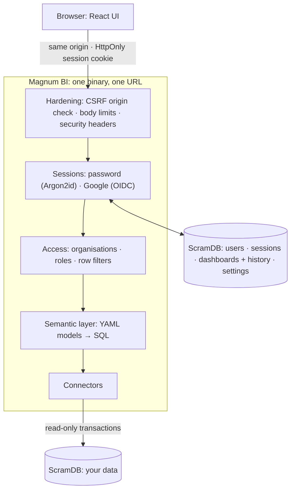

# Magnum BI

A lightweight BI tool: semantic models and dashboards as YAML, queries on
[ScramDB](https://scramdb.com), a drag-and-drop explorer, drill-down, period comparison, and
one-line embedding. The backend is Rust (axum + tokio-postgres); the UI is React.

## Quick start

Prerequisites: Rust 1.88+, Node 20+, and Podman or Docker (for the local ScramDB).

```bash
make install                                  # frontend dependencies
make db-up                                    # ScramDB on 127.0.0.1:55432 (container)
make seed                                     # the `sample_sales` demo table (≈46k rows)
echo 'MAGNUM_SYSTEM_OWNERS=you@example.com' > .env.local
make user EMAIL=you@example.com               # choose a password
make dev-backend                              # API on :8000 (migrates ScramDB on start)
make dev-frontend                             # UI on :5173, in another terminal
```

Open http://localhost:5173 and sign in. The **Sales overview** dashboard runs on the sample data.
For one process serving the API and the built UI on :8000, run `make serve`. Run `make test`
for the backend tests and the frontend typecheck, and `make check` to validate the project files.

## Project layout

```
project/                    your content (git it)
  connections.yaml          named connections (${ENV_VARS} allowed, never secrets in the file)
  models/*.yaml             semantic models: dimensions, measures, drill hierarchies
  dashboards/*.yaml         dashboards seeded into ScramDB on first start (file stem = id)
  themes/*.yaml             optional extra themes
  access.yaml               optional: initial organisations/members, adopted on first start
backend/                    Rust: the API server and CLI (crate `magnum-bi`)
  migrations/*.sql          ScramDB schema, embedded in the binary
  src/
    api/                    HTTP handlers (auth, models & queries, dashboards, admin)
    auth/                   sessions, password sign-in (Argon2id), Google sign-in (OIDC)
    connectors/             where queries run: the Connector trait, ScramDB
    access.rs               organisations, roles, row filters
    compiler.rs             semantic query → SQL
    project.rs, schema.rs   loading and validating the YAML files
    store.rs, db.rs         Magnum BI's own state in ScramDB
frontend/                   React + Vite + ECharts + react-grid-layout
devtools/scramdb.sh         the local ScramDB container (up/down/reset/psql)
```

## Architecture



- **One service, one URL.** The server serves the built UI and `/api`, so the browser only ever
  talks to one origin. Cookies, CSRF checks and the CSP rely on that.
- **State in ScramDB.** Users, sessions, dashboards (with every saved version) and access
  settings live in ScramDB, so the server is stateless and replicas are interchangeable.
  Migrations run at startup (`MAGNUM_DB_AUTO_MIGRATE=0` to turn off; `magnum-bi migrate` runs
  them alone). ScramDB DDL isn't transactional, so every migration statement is idempotent.
- **Data.** Queries are compiled from the models. Only declared fields can be referenced and every
  value is an escaped literal; SQL inside models (`sql:`) is trusted configuration. Queries run in
  `READ ONLY` transactions with a statement timeout. By default the `scramdb` connection reads
  Magnum BI's own database; set `MAGNUM_DATA_DSN` to read another ScramDB.

## Sign-in

Two methods, both ending in the same server-side session (an opaque token in an HttpOnly cookie;
ScramDB stores only its SHA-256):

- **Password** (on by default; `MAGNUM_PASSWORD_LOGIN=0` turns it off). Argon2id hashes, at
  least 10 characters, lockout for 15 minutes after 5 failures. Accounts get a password from:
  - the server: `magnum-bi user set-password you@example.com` (system owners, recovery);
  - an Org admin: **Members › One-time password…** creates a one-time password to hand over. The
    person must choose their own at the next sign-in;
  - the person themselves: **Password** in the top bar.
- **Google** (optional): set `MAGNUM_GOOGLE_CLIENT_ID` / `MAGNUM_GOOGLE_CLIENT_SECRET` (see
  `.env.local.example`). PKCE, a browser-bound state, and an ID token verified against Google's
  keys; only a Google-verified email is accepted, and the email is bound to that Google account.

An account whose password was issued by an Org admin is **bound to that organisation**. With
that password it can never act as a system owner or in another organisation, because the admin
could have created it for an email they don't own. Signing in with Google, or a password set by
a system owner or on the server, isn't bound.

Disable an account with `magnum-bi user disable <email>`; this also ends its sessions.

## Organisations and roles

| role         | can                                                                   |
|--------------|-----------------------------------------------------------------------|
| Viewer       | view dashboards, use their filters and the period picker              |
| User         | + drill down, embed                                                   |
| Power user   | + create / edit / delete dashboards, Explore, see SQL and YAML        |
| Org admin    | + manage the organisation's members, roles and personal filters       |
| System owner | everything, in every organisation (switch with the organisation picker) |

- Each organisation has its own members, dashboards and models, and none of them are visible
  across organisations.
- People join as listed members, or automatically by email domain with a default role (never an
  admin role).
- **Row filters** only ever narrow what someone sees. Organisation filters are set by system
  owners and personal filters by Org admins. A filter also covers every model reading the same
  data (`extends` family, or the same connection and table). Anything misconfigured fails closed.
- Before the first save on **Organisations**, the system owners are `MAGNUM_SYSTEM_OWNERS`.
- Anyone can preview a lower role ("view as"), never a higher one.
- Dashboards in the platform workspace are templates: **Publish…** copies one into organisations.

## Models and dashboards

```yaml
# project/models/sales.yaml
name: sales
connection: scramdb
table: sample_sales            # or sql: SELECT ...
dimensions:
  - {name: sold_at, type: time}           # string | number | boolean | date | time | datetime
  - {name: region}
  - {name: store, aggregation: count_distinct}
measures:
  - {name: revenue, type: sum, sql: amount, format: currency}
  - {name: transactions, type: count}
  - {name: revenue_per_unit, type: number, sql: SUM(amount) / NULLIF(SUM(qty), 0)}
hierarchies:
  location: [region, store]    # drill path
```

A model can `extends:` another and add fields. Dashboards (see
`project/dashboards/sales_overview.yaml`) declare tiles with a query each, dashboard filters, and
an optional dashboard period with comparison (`previous_period`, `previous_year`, or
`{from: <date>}`). Queries support time grains (`sold_at:month`), ad-hoc aggregations of any
column (`sum(amount)`, `count_distinct(store)`), filters, Top/Bottom N and sorting by change
(`-revenue__change`).

Viewers never send queries: they ask for a saved tile with values for the dashboard's own
filters, a period window and drill clicks, and the server rebuilds the query from the saved tile.

## Embedding

```html
<script src="https://bi.example.com/embed.js"></script>
<magnum-dashboard dashboard="sales_overview" filters="category=Footwear"></magnum-dashboard>
```

Or an iframe on `/embed/<id>`. Allowed host pages are set with `MAGNUM_FRAME_ANCESTORS`. For
embeds on other sites, use `MAGNUM_COOKIE_SAMESITE=none` over https.

## Configuration

| variable | default | |
|---|---|---|
| `MAGNUM_DATABASE_URL` | `postgresql://scramdb@127.0.0.1:5432/scramdb` | Magnum BI's ScramDB |
| `MAGNUM_DATA_DSN` | (own database) | data for the `scramdb` connection (`connections.yaml`) |
| `MAGNUM_SYSTEM_OWNERS` | | comma-separated emails, until organisations are first saved |
| `MAGNUM_PUBLIC_URL` | | public https address (cookies `Secure`, OAuth callbacks, origin checks) |
| `MAGNUM_ENV` | development | `production`/`staging` refuse to start with unsafe settings |
| `MAGNUM_PASSWORD_LOGIN` | 1 | password sign-in on/off |
| `MAGNUM_GOOGLE_CLIENT_ID` / `_SECRET` / `_HD` | | Google sign-in |
| `MAGNUM_SESSION_HOURS` | 12 | session lifetime |
| `MAGNUM_COOKIE_SAMESITE` | lax | `none` for cross-site embeds (https only) |
| `MAGNUM_TRUSTED_ORIGINS` | | extra origins allowed to send POST/PUT/DELETE |
| `MAGNUM_FRAME_ANCESTORS` | `'self'` | CSP frame-ancestors for embeds |
| `MAGNUM_HOST` / `MAGNUM_PORT` | 127.0.0.1 / 8000 | listen address |
| `MAGNUM_PROJECT_DIR` / `MAGNUM_FRONTEND_DIST` | `project` / `frontend/dist` | paths |
| `MAGNUM_DB_AUTO_MIGRATE` | 1 | migrate ScramDB at startup |
| `MAGNUM_LOG` | `magnum_bi=info` | log filter |

## Security

- Every rule is enforced by the server; the UI only hides what a role can't use.
- CSRF: state-changing requests must come from Magnum BI's own origin (Origin / Sec-Fetch-Site),
  which covers sibling subdomains too. That's on top of `SameSite=Lax` HttpOnly cookies.
- Headers: a strict CSP, `nosniff`, a referrer policy, HSTS on https, and `no-store` on the API.
- Request bodies are limited to 1 MB; YAML files to 512 KB, with alias expansion capped.
- Query errors show database details only to roles that may see SQL. Everyone else gets a
  reference to look up in the server log.

## Roadmap

Ported from the earlier Python version next, in rough order:

- **Connectors** to other databases. The `Connector` trait (`backend/src/connectors/`), a
  `Connection` variant (`schema.rs`) and, where SQL differs, a `Dialect` (`compiler.rs`).
- Query result caching (models already accept `cache: 15m`).
- Formulas (a calculated-field language), shared per organisation.
- Share links / QR codes, guest links for people without an account.
- Configuration as code (`plan` / `apply` of organisations from git), automation tokens.
- Usage insights, and ThoughtSpot liveboard import.
- TLS to ScramDB (the connection is plain TCP today, so keep ScramDB on a private network).
